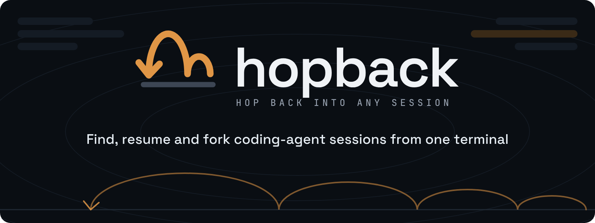
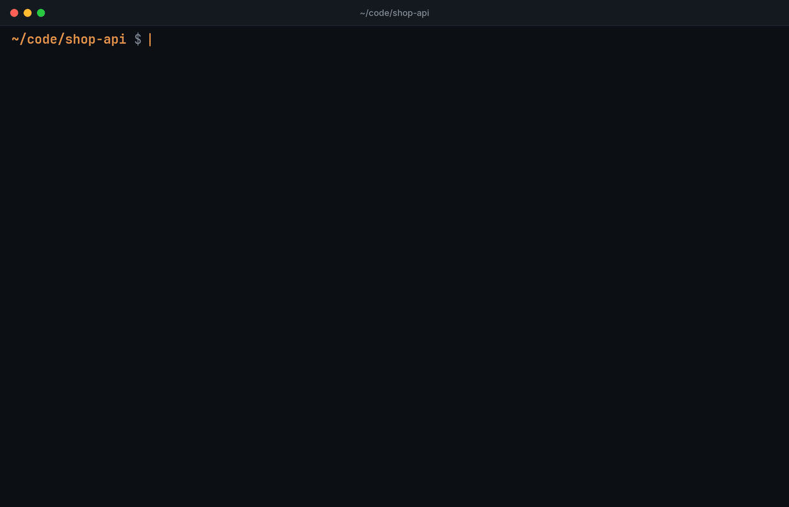
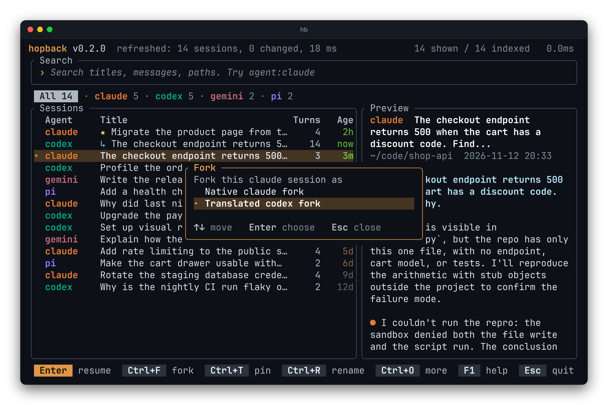
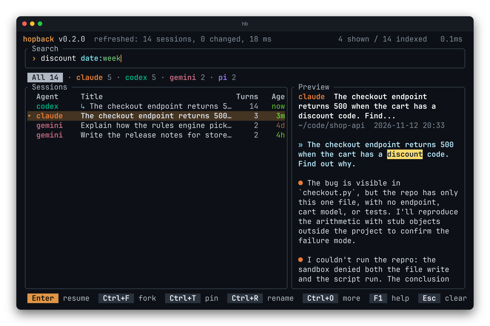

<br />
<p align="center">
  
</p>

<h3><p align="center">Hop back into any coding-agent session</p></h3>

<p align="center">
  <a href="https://crates.io/crates/hopback"></a>
  <a href="https://www.npmjs.com/package/hopback-tui"></a>
</p>

<h4><p align="center">
<a href="#install">[Install]</a>
- <a href="#quick-start">[Quick start]</a>
- <a href="#supported-agents">[Agents]</a>
- <a href="https://avgvi.github.io/hopback/">[Docs]</a>
- <a href="CHANGELOG.md">[Changelog]</a>
</p></h4>

<p align="center">
  <a href="https://crates.io/crates/hopback"></a>
  <a href="https://github.com/avgvi/hopback/actions/workflows/ci.yml"></a>
  
  <a href="LICENSE"></a>
</p>
<br />

`hb` finds your Claude Code, Codex, Antigravity and other agents' sessions in one list, resumes the one you pick in its own folder, and can fork a Claude Code session into Codex or back.



## Install

Pick one. Each installs two commands that are the same program: `hopback` and the short `hb`.

### Homebrew

macOS and Linux.

```bash
brew install avgvi/tap/hopback
```

### Shell installer

A prebuilt binary for macOS or Linux, arm64 or x86_64.

```bash
curl --proto '=https' --tlsv1.2 -LsSf https://github.com/avgvi/hopback/releases/latest/download/hopback-installer.sh | sh
```

### Cargo

```bash
cargo install hopback
```

That builds from source. To download the release binary instead:

```bash
cargo binstall hopback
```

### npm

```bash
npm install -g hopback-tui
```

The package is called `hopback-tui` on npm; the commands it installs are still `hopback` and `hb`. To run it once without installing, use `npx hopback-tui`.

### Python tools

```bash
uv tool install hopback
```

With pipx it is `pipx install hopback`.

### Nix

```bash
nix run github:avgvi/hopback
```

Or add the flake to your profile.

### mise

```bash
mise use -g ubi:avgvi/hopback
```

## Quick start

```bash
hb .              # continue the newest session of this folder, whatever the agent
hb "auth bug"     # search, then resume or fork
hb                # browse the newest sessions
```

- `hb .` skips the list. It resumes the most recently used session whose folder is the current one, or the closest parent folder that has one. `hb . --agent codex` narrows it to one agent, and `hb . --print` shows the folder and command instead of running them.
- In the list, start typing to search titles, messages and paths. Press Enter to resume the selected session with its own agent, in the folder it ran in, and in the permission mode it was started with. `--yolo` or `hb config permission set normal|yolo|inherit` changes that.
- Tab steps through the agents. It writes the filter into the search line (`agent:claude`), so what you see there is always what is being filtered.


Enter puts you back in the agent, with the conversation where you left it:


## Translated forks: move a session to another agent

Press Ctrl+F on a Claude Code session and pick "translated codex fork". hopback reads the conversation, writes it as a new Codex session in the same folder, and opens Codex on it. The same works from Codex to Claude Code. You keep the context when you switch agents: the fork holds the conversation as it was, and the only thing hopback adds is `[hopback]` in front of its title.

```bash
hb fork --to codex claude:5f0c2a9e-...            # same thing from the command line
hb fork --to codex --dry-run claude:5f0c2a9e-...  # see what would be written
hb fork claude:5f0c2a9e-...                       # native fork: the agent forks its own session
```

- Translated forks exist between Claude Code and Codex.
- Native forks are available where the agent has one: Claude Code, Codex, OpenCode and Goose.
- A forked session shows a `↳` mark in the list, and `forked_from` in the JSON output.



## Supported agents

| Agent | Tab | Resumes with | Native fork | Translated fork |
|---|---|---|---|---|
| Claude Code | `claude` | `claude --resume <id>` | yes | to and from Codex |
| Codex | `codex` | `codex resume <id>` | yes | to and from Claude Code |
| Antigravity | `agy` | `agy --conversation <id>` | no | no |
| OpenCode | `opencode` | `opencode <dir> --session <id>` | yes | no |
| Kimi Code | `kimi` | `kimi --session <id>` | no | no |
| Kiro CLI | `kiro` | `kiro-cli chat --resume-id <id>` | no | no |
| Goose | `goose` | `goose session --resume --session-id <id>` | yes | no |
| Pi | `pi` | `pi --session <id>` | no | no |
| Cursor CLI | `cursor` | `agent --resume <id>` | no | no |
| Grok Build | `grok` | `grok --resume <id>` | no | no |
| Gemini CLI | `gemini` | `gemini --resume <id>` | no | no |
| GitHub Copilot CLI | `copilot` | `copilot --resume <id>` | no | no |
| Copilot in VS Code | `vscode` | `code <dir>` | no | no |
| Crush | `crush` | `crush --session <id>` | no | no |
| Mistral Vibe | `vibe` | `vibe --resume <id>` | no | no |

hopback only reads the agents' files. Subagent sessions and sessions with no prompt are left out.

The Goose desktop app on macOS does not put `goose` on `PATH`. When it is missing there, hopback runs the copy inside `Goose.app`.

## Keys

Typing always goes to the search, so actions use a modifier.

| Key | Does |
|---|---|
| Enter | Resume the selected session |
| ↑ ↓, PgUp, PgDn | Move |
| Tab / Shift+Tab | Next or previous agent tab. Tab first finishes a suggested filter value |
| Ctrl+T | Pin to the top, or unpin |
| Ctrl+R or F2 | Rename inside hopback |
| Ctrl+F | Fork |
| Ctrl+Y | Copy the resume command |
| Ctrl+X | Hide from hopback (asks first) |
| Ctrl+O | Menu of the five actions above, each with its key |
| Ctrl+P | Preview on or off |
| F1 | Help: every key on one screen |
| Esc | Clear the search; quit when it is already empty |
| ← → Home End, Ctrl+A, Ctrl+E, Ctrl+W, Ctrl+U, Delete | Edit the search text |
| Mouse | Click selects, double-click resumes, right-click opens the actions menu, the wheel scrolls the list or the preview |

Pinned sessions (`★`) stay at the top. A rename changes the title only inside hopback. Hiding removes a session from hopback's list and nothing else.


## Search

Free text matches titles, messages and folders. Keywords narrow it. They are colored as you type, and a value hopback does not know turns red.

| Keyword | Example | Matches |
|---|---|---|
| `agent:` | `agent:claude`, `agent:claude,codex`, `agent:!codex` | sessions of those agents, or of all but one |
| `dir:` | `dir:backend` | sessions whose folder contains the text |
| `date:` | `date:today`, `date:yesterday`, `date:week`, `date:month`, `date:<3d`, `date:>2w` | sessions by age |

While you type an agent or a date, the rest is suggested after the cursor (`agent:cl` shows `aude`). Tab or → takes it, and the list already shows the suggested filter.



## Scripts and agents

```bash
hb --json --limit 10 "agent:codex api error"   # one JSON object on stdout
hb --json --include-messages --limit 1 "auth"   # with the conversation text
hb pin claude:5f0c2a9e-...                      # also: unpin, rename, hide, unhide
hb fork --json --to codex claude:5f0c2a9e-...   # the new session as JSON, nothing launched
hb --agent-context                              # instructions for a coding agent
```

`--json` has a versioned schema with paging, and every session carries the exact `resume_command`. See [docs/json.md](docs/json.md). `hb --agent-context` prints an Agent Skill that tells a coding agent how to search, page and resume safely; [llms.txt](llms.txt) has the short version.

Shell completions and the man page come from the binary:

```bash
hb completions zsh > ~/.zfunc/_hb     # bash, fish, elvish and powershell too
hopback man > hopback.1
```

## Build from source

```bash
git clone https://github.com/avgvi/hopback
cd hopback
cargo install --path .       # installs hopback and hb into ~/.cargo/bin
```

[AGENTS.md](AGENTS.md) describes the code layout and the checks to run. [docs/packaging.md](docs/packaging.md) covers how releases are built, and [CHANGELOG.md](CHANGELOG.md) what changed.

## License

MIT. See [LICENSE](LICENSE).
