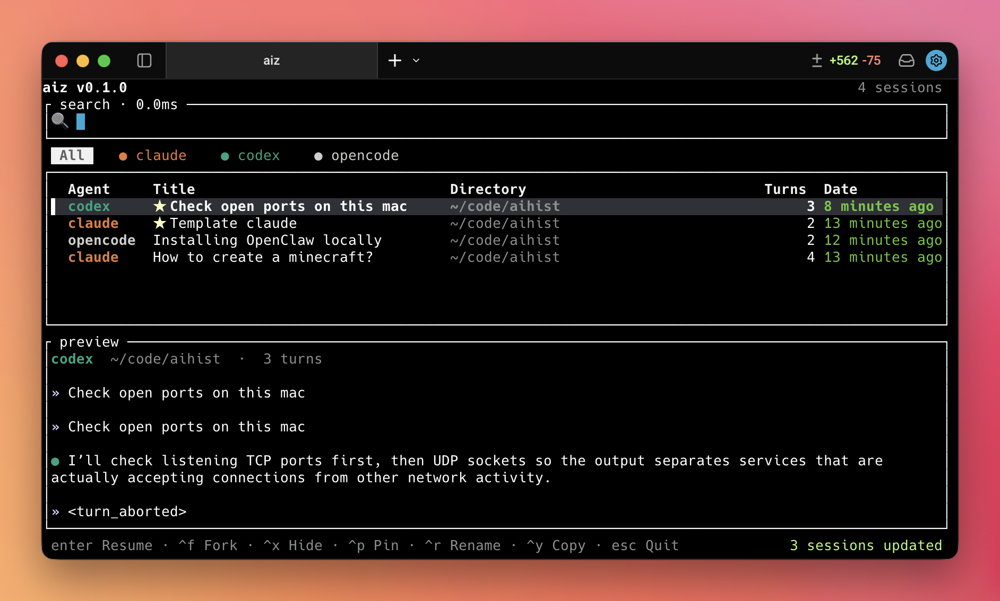

# aiz

> A fast, local-first TUI for finding, resuming, organizing, and forking AI
> coding sessions across Claude Code, Codex, and OpenCode.

`aiz` gives you one searchable index for your agent history. It scans each
agent's local session files, ranks matches with full-text and fuzzy search, and
hands you back into the selected session from its original working directory.

## What You Can Do

- **Find sessions across agents.** Search Claude Code, Codex, and OpenCode
  sessions from one TUI.
- **Resume in place.** Press `Enter` to resume the selected session with the
  agent's own resume flow.
- **Pin important sessions.** Press `Ctrl+P` to keep useful sessions floating at
  the top of the list.
- **Rename sessions locally.** Press `Ctrl+R` to give a session a readable title
  without editing the agent's source files.
- **Fork sessions.** Press `Ctrl+F` to create a new session from the selected
  one. Claude Code, Codex, and OpenCode support native forks where available.
- **Move work between Claude Code and Codex.** Use translated forks to turn a
  Claude Code session into a Codex session, or a Codex session into a Claude Code
  session.
- **Hide noise.** Press `Ctrl+X` to hide sessions from `aiz` without deleting or
  modifying the original agent history.
- **Preview session history.** Toggle the preview pane to inspect the selected
  conversation before resuming or forking it.

## Requirements

Requires a stable Rust toolchain. SQLite is bundled through `rusqlite`, so there
is no separate SQLite install step.

`aiz` currently targets macOS and Linux. Resume handoff uses Unix `exec`, so
Windows is not supported yet.

## Quick Start

Once the TUI is open, start typing to filter sessions by title, directory, or
conversation text. The results update live as you type.

Use `Tab` and `Shift+Tab` to move between Claude Code, Codex, OpenCode, and the
combined view. Use `Up` and `Down` to choose a session.

Toggle the preview pane with `` Ctrl+` `` when you want to inspect the selected
conversation before opening it. Press `Enter` to resume the selected session.

Use `Ctrl+P` to pin important sessions, `Ctrl+R` to rename a session locally,
and `Ctrl+X` to hide sessions you do not want to see in `aiz`.

Use `Ctrl+F` to fork the selected session. Claude Code and Codex sessions can be
translated into each other, and OpenCode supports native forks.

## TUI Controls

| Key | Action |
| --- | --- |
| type | Update the search query. |
| `Up` / `Down` | Move the selection. |
| `PgUp` / `PgDn` | Move by 10 rows. |
| `Tab` / `Shift+Tab` | Cycle agent filters. |
| `Enter` | Resume the selected session. |
| `Ctrl+F` | Fork the selected session. |
| `Ctrl+P` | Pin or unpin the selected session. |
| `Ctrl+R` | Rename the selected session inside `aiz`. |
| `Ctrl+X` | Hide the selected session from `aiz`. |
| `` Ctrl+` `` | Toggle the preview pane. |
| `Ctrl+Up` / `Ctrl+Down` | Resize the preview pane. |
| `Backspace` / `Ctrl+U` | Edit or clear the query. |
| `Esc` / `Ctrl+C` | Quit. |

Pinned, renamed, and hidden states are local `aiz` metadata. They do not edit,
delete, archive, or rewrite the original agent session files.

## Forking

`aiz` supports two fork styles:

- **Native fork:** ask the source agent to fork its own session.
- **Translated fork:** create a new Claude Code or Codex session from the other
  agent's conversation history.

From the TUI, select a session and press `Ctrl+F`. If more than one fork target
is available, `aiz` opens a target picker.

Translated forks are intentionally limited to Claude Code and Codex. Source
session files are read-only; `aiz` writes a new target-agent session file and then
launches the target agent.

## License

MIT.
