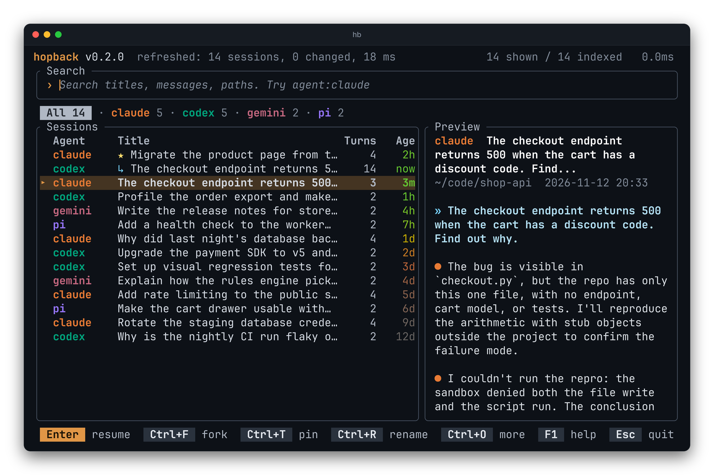
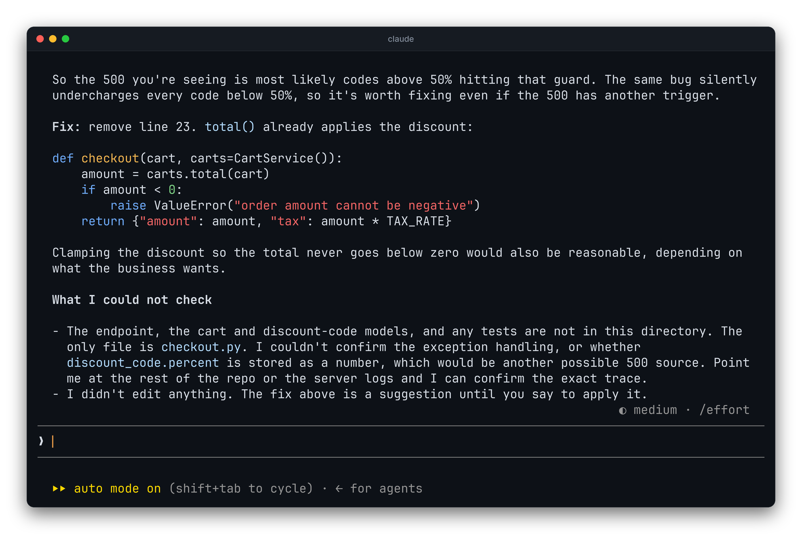

```bash
hb .              # continue the newest session of this folder, whatever the agent
hb "auth bug"     # search, then resume or fork
hb                # browse the newest sessions
```



## Continue in this folder

`hb .` skips the list. It resumes the most recently used session whose folder
is the current one, or the closest parent folder that has one.

```bash
hb . --agent codex   # only Codex sessions
hb . --print         # show the folder and command instead of running them
```

## Browse and resume

In the list, start typing to search titles, messages and paths. Press Enter to
resume the selected session with its own agent, in the folder it ran in, and
in the permission mode it was started with. `--yolo` or
`hb config permission set normal|yolo|inherit` changes that.



Tab steps through the agents. It writes the filter into the search line
(`agent:claude`), so what you see there is always what is being filtered.

## Where to go next

- [Search](../../guides/search/): the `agent:`, `dir:` and `date:` filters.
- [Keys and mouse](../../guides/keys/): pin, rename, hide and copy.
- [Fork to another agent](../../guides/forks/): move a session from Claude Code to Codex, or back.
