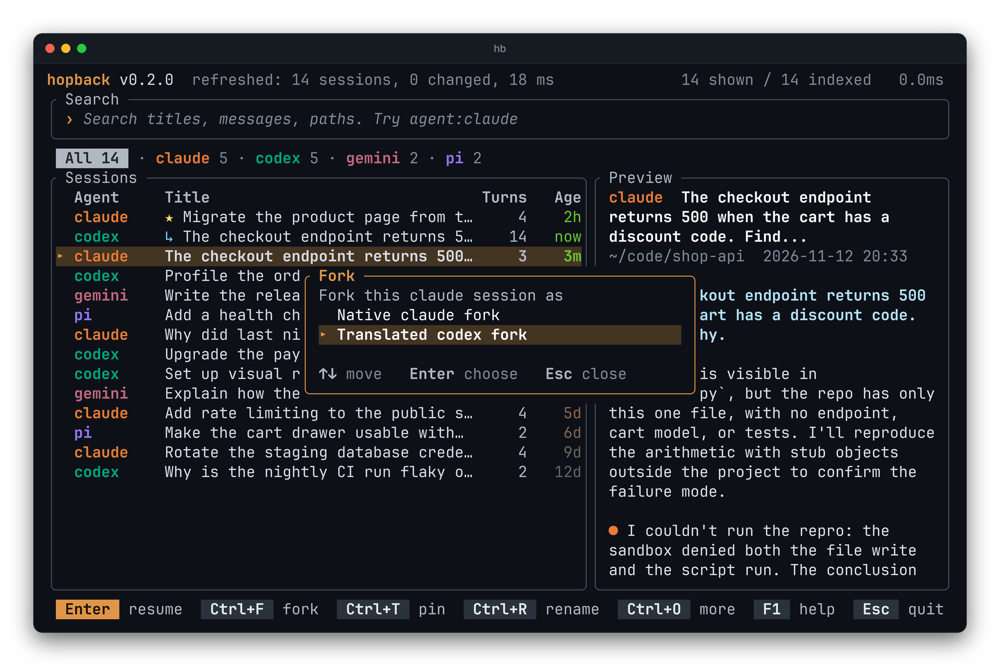

Press Ctrl+F on a Claude Code session and pick "translated codex fork".
hopback reads the conversation, writes it as a new Codex session in the same
folder, and opens Codex on it. The same works from Codex to Claude Code. You
keep the context when you switch agents: the fork holds the conversation as it
was, and the only thing hopback adds is `[hopback]` in front of its title.



## From the command line

```bash
hb fork --to codex claude:5f0c2a9e-...            # same thing from the command line
hb fork --to codex --dry-run claude:5f0c2a9e-...  # see what would be written
hb fork claude:5f0c2a9e-...                       # native fork: the agent forks its own session
```

## Two kinds of fork

- **Translated forks** exist between Claude Code and Codex.
- **Native forks** are available where the agent has one: Claude Code, Codex,
  OpenCode and Goose.

A forked session shows a `↳` mark in the list, and `forked_from` in the
[JSON output](../../reference/json/).
