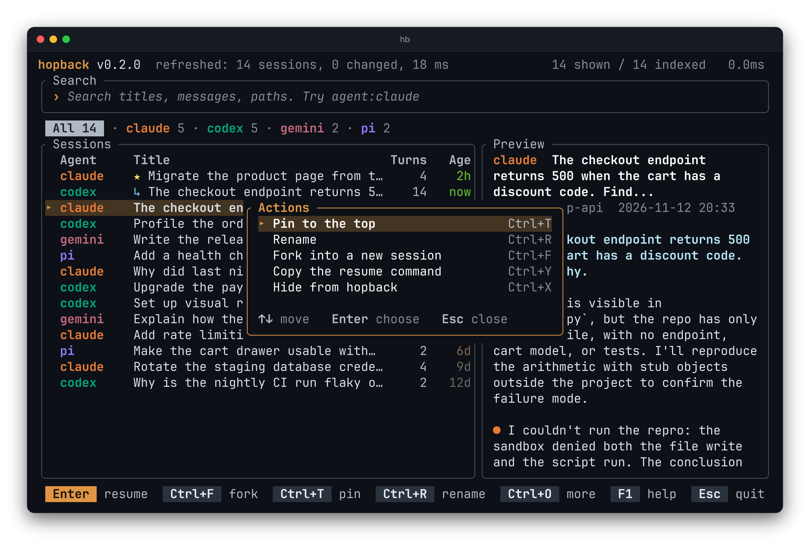

Typing always goes to the search, so actions use a modifier.

| Key | Does |
|---|---|
| Enter | Resume the selected session |
| ↑ ↓, PgUp, PgDn | Move |
| Tab / Shift+Tab | Next or previous agent tab. Tab first finishes a suggested filter value |
| Ctrl+T | Pin to the top, or unpin |
| Ctrl+R or F2 | Rename inside hopback |
| Ctrl+F | Fork |
| Ctrl+Y | Copy the resume command |
| Ctrl+X | Hide from hopback (asks first) |
| Ctrl+O | Menu of the five actions above, each with its key |
| Ctrl+P | Preview on or off |
| F1 | Help: every key on one screen |
| Esc | Clear the search; quit when it is already empty |
| ← → Home End, Ctrl+A, Ctrl+E, Ctrl+W, Ctrl+U, Delete | Edit the search text |



## Pin, rename and hide

Pinned sessions (`★`) stay at the top. A rename changes the title only inside
hopback. Hiding removes a session from hopback's list and nothing else.

The same actions exist as commands:

```bash
hb pin claude:5f0c2a9e-...      # also: unpin, rename, hide, unhide
```

## Mouse

Click selects, double-click resumes, right-click opens the actions menu, and
the wheel scrolls the list or the preview.
