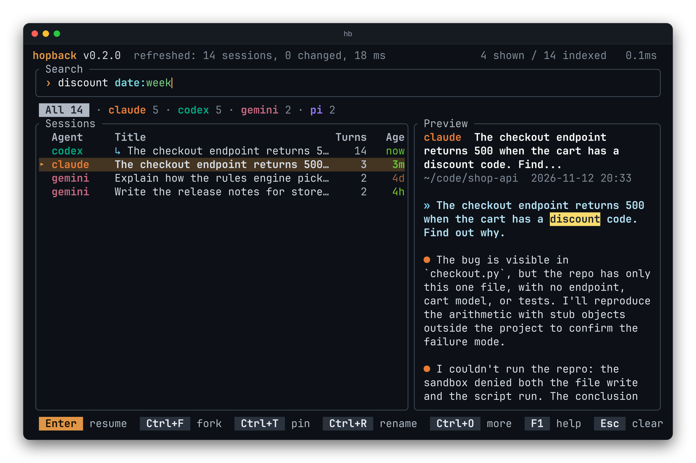

Free text matches titles, messages and folders. Keywords narrow it. They are
colored as you type, and a value hopback does not know turns red.



## Keywords

| Keyword | Example | Matches |
|---|---|---|
| `agent:` | `agent:claude`, `agent:claude,codex`, `agent:!codex` | sessions of those agents, or of all but one |
| `dir:` | `dir:backend` | sessions whose folder contains the text |
| `date:` | `date:today`, `date:yesterday`, `date:week`, `date:month`, `date:<3d`, `date:>2w` | sessions by age |

## Suggestions

While you type an agent or a date, the rest is suggested after the cursor
(`agent:cl` shows `aude`). Tab or → takes it, and the list already shows the
suggested filter.

## The agent tabs are search text

Tab steps through the agents by rewriting the `agent:` filter in the search
line, so what you see there is always what is being filtered.

## From the command line

The same text works as an argument, and with `--json`:

```bash
hb "auth bug"
hb --json --limit 10 "agent:codex api error"
```
