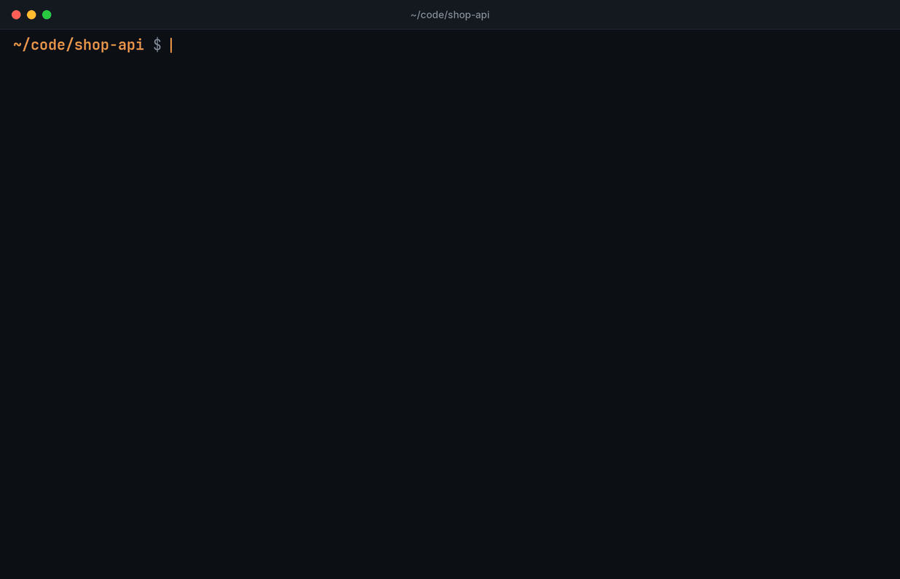

import { Card, CardGrid } from '@astrojs/starlight/components';

<CardGrid>
	<Card title="One list for 15 agents" icon="list-format">
		Claude Code, Codex, Antigravity, OpenCode, Gemini CLI and ten more, newest
		first, with a preview of each conversation. See the [supported
		agents](reference/agents/).
	</Card>
	<Card title="Continue where you were" icon="rocket">
		`hb .` resumes the newest session of the folder you are in, whatever the
		agent. No list, no search.
	</Card>
	<Card title="Search everything" icon="magnifier">
		Type to search titles, messages and paths. Narrow it with `agent:`, `dir:`
		and `date:` [filters](guides/search/).
	</Card>
	<Card title="Fork across agents" icon="code-branch">
		Ctrl+F turns a Claude Code session into a Codex session, or back, and
		[keeps the context](guides/forks/).
	</Card>
	<Card title="Made for scripts and agents" icon="seti:json">
		`hb --json` prints one JSON object with a [versioned
		schema](reference/json/), and `hb --agent-context` tells a coding agent how
		to use it.
	</Card>
	<Card title="Keep the list tidy" icon="star">
		Pin sessions to the top, rename them, or hide the ones you are done with,
		straight from the list. See [keys and mouse](guides/keys/).
	</Card>
</CardGrid>
